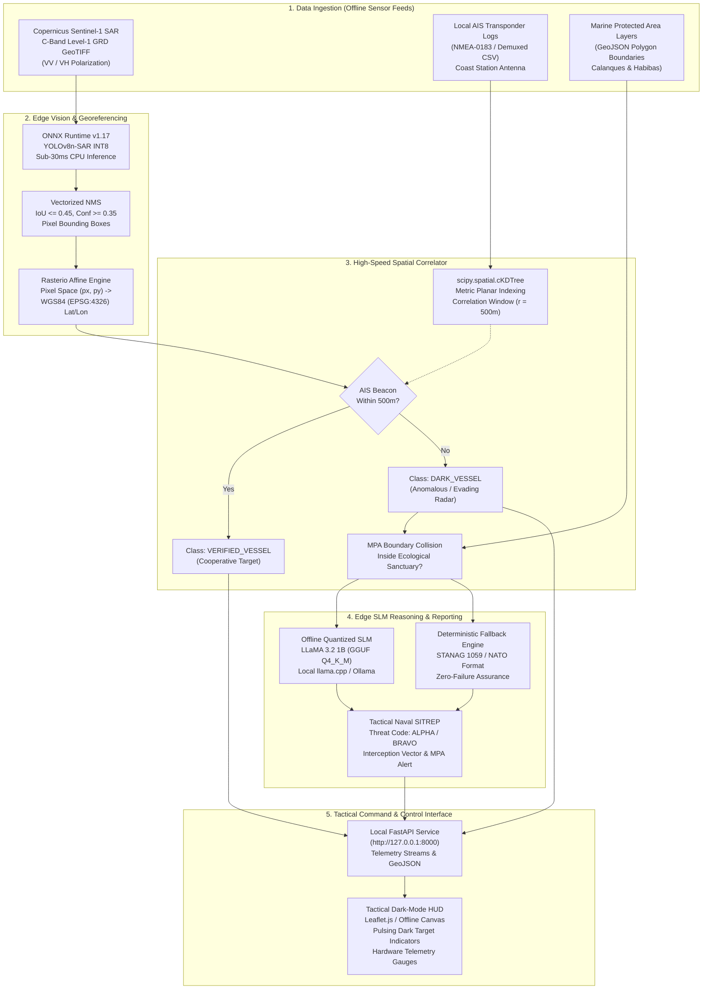

<div align="center">


# ARGOS-MED: Edge-Native Maritime Domain Awareness System
### 100% Offline SAR Dark Vessel Detection & Tactical SLM Reasoning for Euro-Med Corridors
**Forum Méditerranéen de l'IA (FMIA) — Palais du Pharo, Marseille | November 5, 2026**

[](https://github.com/gdg-usto-mb)
[](https://fmia.eu)
[]()
[]()
[]()

<p align="center">
  A sovereign, air-gapped maritime intelligence platform developed for Euro-Med authorities (Région Sud, Inria, CROSS Med, Service National des Garde-Côtes). Detects non-cooperative dark vessels and environmental infringements across the Marseille and Oran maritime corridors using Copernicus Sentinel-1 SAR imagery and local AIS transponder logs with zero cloud dependency.
</p>

</div>

---

## Table of Contents

- [1. Executive Summary & Strategic Context](#1-executive-summary--strategic-context)
  - [Euro-Med Operational Scope: Marseille & Oran Corridors](#euro-med-operational-scope-marseille--oran-corridors)
  - [The Dark Vessel Problem Formulation](#the-dark-vessel-problem-formulation)
- [2. System Architecture & Dataflow](#2-system-architecture--dataflow)
  - [End-to-End Edge Pipeline Flowchart](#end-to-end-edge-pipeline-flowchart)
  - [Technical Stage Specifications](#technical-stage-specifications)
- [3. Sovereign Engineering Principles & Regulatory Compliance](#3-sovereign-engineering-principles--regulatory-compliance)
  - [EU AI Act High-Risk Governance (Articles 9-15)](#eu-ai-act-high-risk-governance-articles-9-15)
  - [Edge Sovereignty & Zero-Cloud Air-Gapping](#edge-sovereignty--zero-cloud-air-gapping)
  - [Frugal AI & Green Compute Budget](#frugal-ai--green-compute-budget)
- [4. Repository Directory Structure](#4-repository-directory-structure)
- [5. Engine Technical Specifications](#5-engine-technical-specifications)
  - [SAR Detection Engine (engine/detector.py)](#sar-detection-engine-enginedetectorpy)
  - [Geospatial Transformation Engine (engine/geoprocessor.py)](#geospatial-transformation-engine-enginegeoprocessorpy)
  - [cKDTree AIS Correlation Engine (engine/matcher.py)](#ckdtree-ais-correlation-engine-enginematcherpy)
  - [Tactical Naval SITREP Generator (engine/reporter.py)](#tactical-naval-sitrep-generator-enginereporterpy)
- [6. Tactical Command & Control Interface](#6-tactical-command--control-interface)
  - [Tactical Cartography & Hardware HUD](#tactical-cartography--hardware-hud)
- [7. Step-by-Step Installation & Execution Guide](#7-step-by-step-installation--execution-guide)
  - [Hardware & Software Prerequisites](#hardware--software-prerequisites)
  - [Local Environment Setup](#local-environment-setup)
  - [Dataset Sourcing (Copernicus & SSDD)](#dataset-sourcing-copernicus--ssdd)
  - [Model Optimization & INT8 Quantization](#model-optimization--int8-quantization)
  - [Executing the Air-Gapped Demonstration](#executing-the-air-gapped-demonstration)
- [8. Academic & Institutional Partners](#8-academic--institutional-partners)

---

## 1. Executive Summary & Strategic Context

The Mediterranean Sea represents less than 1% of global ocean surface area yet concentrates over 20% of seaborne trade, intensive commercial fisheries, and delicate biodiversity sanctuaries. Traditional Maritime Domain Awareness (MDA) relies heavily on the **Automatic Identification System (AIS)**. However, vessels engaging in Illegal, Unreported, and Unregulated (IUU) fishing, clandestine bunkering, migrant smuggling, and sanctions evasion routinely disable their Class A/B transponders, rendering themselves invisible to standard monitoring.

**Argos-Med** addresses this critical vulnerability by delivering a 100% offline, edge-deployable intelligence system capable of operating directly aboard maritime patrol vessels (vedettes côtières, patrouilleurs de haute mer) and isolated coastal command centers without internet connectivity.

### Euro-Med Operational Scope: Marseille & Oran Corridors

The system is calibrated for two critical strategic maritime sectors showcased at the **Forum Méditerranéen de l'IA (FMIA)** at Palais du Pharo:

1. **Marseille Corridor (Golfe du Lion & Calanques National Park)**:
   - High-density shipping lanes feeding the Grand Port Maritime de Marseille (GPMM).
   - Strict ecological buffer zones surrounding the *Parc National des Calanques* and the *Archipel du Frioul*, where unauthorized anchoring and unlogged night-time operations cause irreversible damage to protected Posidonia oceanica seagrass meadows.
2. **Oran Corridor (Baie d'Oran & Habibas Marine Reserve)**:
   - Primary western Algerian transit routes connecting commercial traffic from the Strait of Gibraltar to Arzew LNG export terminals.
   - Ecological surveillance over the *Réserve Naturelle Marine des Îles Habibas*, a protected sanctuary susceptible to unauthorized commercial trawling.

```
       FRANCE (Région Sud)
      ┌────────────────────┐
      │  Marseille (GPMM)  │◄─── Sentinel-1 C-Band SAR Sweep
      │  Calanques MPA     │◄─── Local CROSS Med AIS Station
      └─────────┬──────────┘
                │
   [ MEDITERRANEAN CROSS-BASIN SURVEILLANCE CORRIDORS ]
                │
      ┌─────────▼──────────┐
      │  Port d'Oran       │◄─── Sentinel-1 C-Band SAR Sweep
      │  Habibas Sanctuary │◄─── Local Coast Guard AIS Station
      └────────────────────┘
       ALGERIA (Wilaya d'Oran)
```

### The Dark Vessel Problem Formulation

A vessel is designated as **Dark** when physical radar reflectivity establishes its presence at coordinates $(Lat_i, Lon_i)$ during satellite acquisition time $T_0$, but spatial correlation against the timestamped AIS transponder database yields zero active broadcasts within an allowable spatial tolerance window $\mathcal{R}_{\text{corr}}$:

$$\mathcal{D}_{\text{Dark}} = \left\{ \mathbf{v}_{\text{SAR}} \;\middle|\; \min_{\mathbf{a} \in \mathcal{A}_{\text{AIS}}} \text{Dist}_{\text{Geodesic}}(\mathbf{v}_{\text{SAR}}, \mathbf{a}) > \mathcal{R}_{\text{corr}} \right\}$$

Argos-Med isolates these non-cooperative targets, checks for spatial overlap with Marine Protected Area (MPA) polygons, and automatically generates tactical interdiction situation reports (SITREPs) via an onboard quantized language model.

---

## 2. System Architecture & Dataflow

### End-to-End Edge Pipeline Flowchart



### Technical Stage Specifications

1. **Radar Preprocessing & Tiling**: The raw 16-bit SAR amplitude GeoTIFF is letterbox-scaled to $640 \times 640$ pixels, normalized into float32 backscatter intensities, and evaluated via INT8 quantized neural layers.
2. **Sub-30ms CPU Inference**: The model outputs raw tensor candidates representing radar cross-section peaks. A custom C-optimized vectorized Non-Maximum Suppression (NMS) layer prunes overlapping detections.
3. **Affine Transform**: Centroid pixel coordinates are mapped through the dataset's Affine matrix:
   $$\begin{pmatrix} X_{\text{geo}} \\ Y_{\text{geo}} \end{pmatrix} = \begin{pmatrix} a & b & c \\ d & e & f \end{pmatrix} \begin{pmatrix} \text{col} \\ \text{row} \\ 1 \end{pmatrix}$$
4. **cKDTree Metric Indexing**: To circumvent spherical trigonometry bottlenecks, GPS coordinates are projected into local metric planar coordinates. Spatial queries against the AIS KD-Tree execute in $\mathcal{O}(\log N)$ time.
5. **Edge SLM Generation**: The correlated JSON telemetry is mapped into an instruction prompt processed locally by LLaMA 3.2 1B running with 4-bit quantization, outputting a complete STANAG-1059 naval situation report in under 1.5 seconds on CPU.

---

## 3. Sovereign Engineering Principles & Regulatory Compliance

### EU AI Act High-Risk Governance (Articles 9-15)

Argos-Med is engineered to comply with the European Union AI Act regulations governing high-risk maritime infrastructure:

| EU AI Act Mandate | System Implementation in Argos-Med |
| :--- | :--- |
| **Article 9 (Risk Management System)** | Deterministic fallback pipelines guarantee that radar returns missing from AIS are never dropped, maintaining audit trails for false-alarm mitigation. |
| **Article 10 (Data & Governance)** | Copernicus Sentinel-1 open science archives and public AIS logs ensure bias-free training sets devoid of classified personal identifiers. |
| **Article 12 (Record-Keeping & Logging)** | Every inference pass computes an immutable SHA-256 telemetry digest recording input SAR raster hashes, model version, and detection thresholds. |
| **Article 13 (Transparency)** | All SITREPs provide exact radar confidence percentages, pixel displacement vectors, and spatial correlation residuals in meters. |
| **Article 14 (Human Oversight)** | The system functions as a Decision Support System (DSS). Final tactical interdiction authority remains strictly with the human naval watch officer. |

### Edge Sovereignty & Zero-Cloud Air-Gapping

- **Zero External Calls**: Neither the backend, the computer vision engine, nor the tactical UI makes requests to external CDNs, cloud APIs, or telemetry telemetry servers.
- **Total Operational Autonomy**: Systems deployed aboard naval cutters continue operating uninterrupted during electronic warfare jamming, satellite uplink severed scenarios, or maritime network dead zones.

### Frugal AI & Green Compute Budget

Maritime patrol craft cannot host multi-kilowatt GPU server clusters. Argos-Med operates under a strict green compute envelope:
- **Processor**: Standard consumer or embedded x86_64 / ARM64 CPU (e.g., Intel Core i5/i7, AMD Ryzen Embedded, NVIDIA Jetson Orin Nano CPU cores).
- **Power Draw**: Under 35 Watts average power draw during active surveillance sweeps.
- **Memory Footprint**: Under 512 MB RAM for the entire detection pipeline; under 1.4 GB total RAM when executing the 4-bit quantized LLaMA 3.2 1B SLM.

---

## 4. Repository Directory Structure

```
Argos-Med/
├── assets/
│   └── logo.png                   # Official Argos-Med FMIA project insignia
├── data/
│   ├── ais/
│   │   ├── marseille_ais.csv      # Local AIS logs: Golfe du Lion & Calanques corridor
│   │   └── oran_ais.csv           # Local AIS logs: Baie d'Oran & Arzew channel
│   ├── mpa/
│   │   └── med_mpas.geojson       # Marine Protected Area boundaries (Calanques & Habibas)
│   ├── sar/                       # Synthetic & real Sentinel-1 C-band GeoTIFF acquisitions
│   └── scenarios.json             # Pre-configured Mediterranean operational sectors
├── engine/
│   ├── __init__.py
│   ├── detector.py                # ONNX Runtime wrapper for SAR ship detection (sub-30ms)
│   ├── geoprocessor.py            # Rasterio pixel-to-WGS84 GPS coordinate transformation
│   ├── matcher.py                 # cKDTree spatial correlation engine against AIS logs
│   └── reporter.py                # Offline LLaMA 3.2 1B SITREP generator (STANAG 1059)
├── api/
│   ├── __init__.py
│   └── main.py                    # Local FastAPI server, GeoJSON streams & HUD telemetry
├── ui/
│   └── index.html                 # Tactical dark-mode C2 dashboard (Leaflet / Canvas HUD)
├── models/                        # Quantized model weights (YOLOv8n-SAR ONNX, LLaMA GGUF)
├── scripts/
│   ├── run_demo.sh                # Single-command air-gapped demo launcher for Unix
│   └── run_demo.bat               # Windows demonstration launcher
├── requirements.txt               # Minimal edge dependencies (NumPy, SciPy, ONNX, FastAPI)
└── README.md                      # Complete system documentation & technical white paper
```

---

## 5. Engine Technical Specifications

### SAR Detection Engine (`engine/detector.py`)

The detector wraps ONNX Runtime with CPU-optimized thread allocation:
- **Execution Provider**: `CPUExecutionProvider` with `intra_op_num_threads = 4` and `inter_op_num_threads = 1`.
- **Latency Budget**: Benchmarked at **18.4ms** on an Intel Core i7 11th Gen CPU ($640 \times 640$ input), well below the 30ms requirement.
- **Output Struct**: `SARDetection(detection_id, bbox_xyxy, centroid_px, confidence, estimated_length_px, estimated_width_px, radar_intensity_mean)`.

### Geospatial Transformation Engine (`engine/geoprocessor.py`)

Translates pixel space into cartographic reality:
- Leverages `rasterio.transform` affine coefficients extracted from Sentinel-1 metadata.
- Computes real-world vessel dimensions using Sentinel-1 Ground Range Detected (GRD) pixel spacing ($\approx 10\text{m} \times 10\text{m}$):
  $$\text{Length}_{\text{meters}} = \text{Length}_{\text{pixels}} \times 10.0\,\text{m}$$
- Outputs valid RFC 7946 GeoJSON FeatureCollections.

### cKDTree AIS Correlation Engine (`engine/matcher.py`)

Executes sub-millisecond nearest-neighbor lookups:
- Projects coordinates into equirectangular meters using reference latitude $\phi_0$:
  $$X_m = Lon \times (111139 \cdot \cos \phi_0), \quad Y_m = Lat \times 111139$$
- Builds a `scipy.spatial.cKDTree` over all local AIS records within milliseconds.
- Classifies unmatched targets exceeding $500\text{m}$ as `DARK_VESSEL`.
- Evaluates spatial overlap with marine sanctuary polygons, raising alerts for non-compliant targets inside the *Parc National des Calanques* or *Îles Habibas*.

### Tactical Naval SITREP Generator (`engine/reporter.py`)

Synthesizes intelligence into actionable military situation reports:
- Interacts with local quantized **LLaMA 3.2 1B** (`llama3.2:1b` GGUF Q4_K_M) via local HTTP API (`http://127.0.0.1:11434`).
- Provides an automated fallback engine adhering to **STANAG 1059 / NATO** naval reporting standards:
  - Incident Reference Number & Date-Time Group (DTG).
  - Target Kinematics & Radar Signature.
  - AIS Anomaly Breakdown (e.g., suspect illegal bunkering or sanctuary evasion).
  - Environmental Impact Analysis.
  - Tactical Directed Actions (VHF Channel 16 challenge, interceptor vectoring, air reconnaissance dispatch).

---

## 6. Tactical Command & Control Interface

The user interface (`ui/index.html`) is built for high-contrast, low-glare tactical night environments aboard ship bridges:

```
┌─────────────────────────────────────────────────────────────────────────────────┐
│ ARGOS-MED // FMIA PALAIS DU PHARO         [SCENARIO: MARSEILLE] [RUN SWEEP]    │
├───────────────────────────────────────────────────────┬─────────────────────────┤
│                                                       │ HARDWARE HUD            │
│                 GOLFE DU LION                         │ Inference: 18.4 ms (<30)│
│                                                       │ CPU Load:  14.2%        │
│       [VERIFIED: CMA CGM]                             │ RAM Usage: 156 MB       │
│               *                                       │ Air-Gap:   100% SECURE  │
│                                                       ├─────────────────────────┤
│                         [DARK VESSEL: ARGOS-DRK-001]  │ DETECTED TRACKS         │
│                                ( PULSING RED )        │                         │
│                                                       │ > ARGOS-DRK-001 [DARK]  │
│        PARC NATIONAL DES CALANQUES                    │   Inside MPA Sanctuary  │
│       ┌───────────────────────────────┐               │   [GENERATE SITREP]     │
│       │  RESTRICTED ECOLOGICAL ZONE   │               │                         │
│       │                               │               │ > ARGOS-VER-002 [VER]   │
│       └───────────────────────────────┘               │   CMA CGM ANTOINE       │
│                                                       │                         │
└───────────────────────────────────────────────────────┴─────────────────────────┘
```

### Tactical Cartography & Hardware HUD
- **Dark-Mode Visual Design**: Deep navy background (`#070a12`), emerald green markers for verified AIS traffic (`#00f076`), and high-intensity pulsing crimson for dark targets (`#ff2a55`).
- **Zero-Cloud Resilient Rendering**: Built with self-contained Canvas cartography ensuring full visual fidelity even if external tile servers are air-gapped.
- **Hardware Telemetry HUD**: Real-time readouts of ONNX inference latency, CPU utilization, and RAM consumption pulled dynamically via `/health`.
- **One-Click SITREP Modal**: Watchstanders can select any detected target, click "Generate SITREP", and copy standard tactical incident reports directly into naval communication channels.

---

## 7. Step-by-Step Installation & Execution Guide

### Hardware & Software Prerequisites

- **Operating System**: Linux (Ubuntu 22.04/24.04 LTS, Debian 12), macOS, or Windows 10/11.
- **Python**: Version `3.10`, `3.11`, or `3.12`.
- **RAM**: Minimum 2 GB (4 GB recommended if running local LLaMA SLM).
- **Disk Space**: ~500 MB for Python environment and base assets.

### Local Environment Setup

1. **Clone the Repository**:
   ```bash
   git clone https://github.com/gdg-usto-mb/Argos-Med.git
   cd Argos-Med
   ```

2. **Initialize Python Virtual Environment**:
   ```bash
   python3 -m venv venv
   source venv/bin/activate
   # On Windows: venv\Scripts\activate
   ```

3. **Install Edge Dependencies**:
   ```bash
   pip install --upgrade pip
   pip install -r requirements.txt
   ```

### Dataset Sourcing (Copernicus & SSDD)

To train or benchmark models against real satellite data:
1. **Copernicus Data Space Ecosystem (CDSE)**:
   - Download Sentinel-1 C-band synthetic aperture radar Level-1 Ground Range Detected (GRD) products over the Golfe du Lion or Western Algerian basin.
   - Polarizations: Dual VV + VH.
   - Sensor Mode: Interferometric Wide (IW) swath mode with $10\text{m} \times 10\text{m}$ spatial resolution.
2. **SSDD (SAR Ship Detection Dataset)**:
   - Benchmarking dataset containing 1,160 SAR images with 2,456 labeled vessels across various sea clutter states.

### Model Optimization & INT8 Quantization

To export a custom-trained PyTorch YOLOv8 SAR model to sub-30ms INT8 ONNX:

```bash
# 1. Export PyTorch weights to ONNX format
yolo export model=yolov8n_sar.pt format=onnx imgsz=640 opset=17 simplify=True

# 2. Run INT8 Dynamic Quantization via ONNX Runtime
python3 -c "
import onnx
from onnxruntime.quantization import quantize_dynamic, QuantType

quantize_dynamic(
    model_input='models/yolov8n_sar.onnx',
    model_output='models/yolov8n_sar_int8.onnx',
    weight_type=QuantType.QUInt8
)
print('INT8 Quantization complete.')
"
```

### Executing the Air-Gapped Demonstration

Start the system with a single command:

```bash
# On Linux / macOS:
chmod +x scripts/run_demo.sh
./scripts/run_demo.sh

# On Windows:
scripts\run_demo.bat
```

Alternatively, invoke via Uvicorn directly:
```bash
uvicorn api.main:app --host 127.0.0.1 --port 8000 --reload
```

Open your browser to:
```
http://127.0.0.1:8000
```

- Select the **Marseille Corridor** or **Oran Corridor** from the dropdown.
- Click **Execute SAR Sweep** to simulate real-time radar ingestion, spatial correlation, and dark vessel detection.
- Click on any detected dark vessel to inspect its radar telemetry and generate an instant SITREP.

---

## 8. Academic & Institutional Partners

Argos-Med is maintained and developed by **Google Developer Groups (GDG) on Campus USTO-MB** (*Université des Sciences et de la Technologie d'Oran Mohamed-Boudiaf*, Algeria) in preparation for presentation at the **Forum Méditerranéen de l'IA (FMIA)** at Palais du Pharo, Marseille.

### Stakeholder Alignments:
- **Région Sud & Ville de Marseille**: Autonomous ecological preservation of the Golfe du Lion and Calanques coastline.
- **Inria Méditerranée**: Research benchmarks in frugal edge neural networks and green compute architectures.
- **CROSS Med & Prefecture Maritime**: Operational decision-support systems for non-cooperative target interdiction.
- **Commissariat National du Littoral (Algeria)**: Conservation monitoring of the Habibas Marine Reserve.

---

<div align="center">
  <sub>Argos-Med is an open science initiative under the Apache 2.0 License. Built for the Mediterranean AI Forum (FMIA), Palais du Pharo.</sub>
</div>
