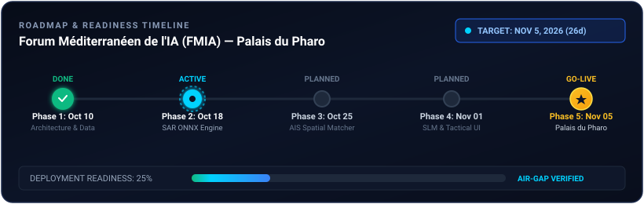
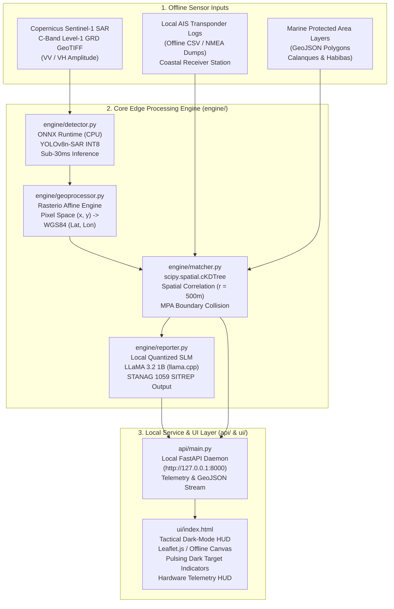

<div align="center">


# ARGOS-MED: Edge-Native Maritime Domain Awareness System
### 100% Offline SAR Dark Vessel Detection & Tactical SLM Reasoning for Euro-Med Corridors
**Forum Méditerranéen de l'IA (FMIA) — Palais du Pharo, Marseille | November 5, 2026**

[](https://github.com/gdg-usto-mb)
[](https://fmia.eu)
[]()
[]()
[]()

<p align="center">
  A high-impact project initiative by <b>Google Developer Groups on Campus USTO-MB</b> for the Mediterranean AI Forum. Architected as a 100% offline, air-gapped maritime intelligence system detecting non-cooperative dark vessels and ecological infringements across the Marseille and Oran corridors using Copernicus Sentinel-1 SAR imagery and local AIS logs.
</p>

</div>

---

<div align="center" style="margin: 20px 0;">
  
</div>

---

## Table of Contents

- [1. Project Vision & Executive Summary](#1-project-vision--executive-summary)
  - [The Operational Problem: Dark Vessels & Marine Sanctuaries](#the-operational-problem-dark-vessels--marine-sanctuaries)
  - [Target Corridors: Marseille & Oran](#target-corridors-marseille--oran)
- [2. System Architecture & High-Level Dataflow](#2-system-architecture--high-level-dataflow)
  - [Pipeline Flowchart](#pipeline-flowchart)
  - [Data Pipeline Stages](#data-pipeline-stages)
- [3. Core Technical Constraints](#3-core-technical-constraints)
  - [100% Offline / Zero-Cloud Sovereignty](#100-offline--zero-cloud-sovereignty)
  - [Sub-30ms CPU Inference Budget](#sub-30ms-cpu-inference-budget)
  - [Edge Reasoning via Quantized SLM](#edge-reasoning-via-quantized-slm)
  - [EU AI Act High-Risk Compliance & Frugal AI](#eu-ai-act-high-risk-compliance--frugal-ai)
- [4. Repository Directory Structure](#4-repository-directory-structure)
- [5. Team Implementation Roadmap & Workstreams](#5-team-implementation-roadmap--workstreams)
  - [Workstream 1: SAR Perception & ONNX Inference (engine/detector.py)](#workstream-1-sar-perception--onnx-inference-enginedetectorpy)
  - [Workstream 2: Geospatial Geoprocessing (engine/geoprocessor.py)](#workstream-2-geospatial-geoprocessing-enginegeoprocessorpy)
  - [Workstream 3: Spatial Correlation & MPA Rules (engine/matcher.py)](#workstream-3-spatial-correlation--mpa-rules-enginematcherpy)
  - [Workstream 4: Tactical SLM SITREP Generator (engine/reporter.py)](#workstream-4-tactical-slm-sitrep-generator-enginereporterpy)
  - [Workstream 5: Local Backend & Telemetry API (api/main.py)](#workstream-5-local-backend--telemetry-api-apimainpy)
  - [Workstream 6: Tactical Dark-Mode C2 Dashboard (ui/index.html)](#workstream-6-tactical-dark-mode-c2-dashboard-uiindexhtml)
- [6. Data Sources & Preparation Guide](#6-data-sources--preparation-guide)
- [7. Contribution Conventions for GDG Developers](#7-contribution-conventions-for-gdg-developers)
- [8. Project Leadership & Contributors](#8-project-leadership--contributors)

---

## 1. Project Vision & Executive Summary

The Mediterranean Sea concentrates intense maritime commerce alongside vulnerable marine ecosystems. Maritime Domain Awareness (MDA) currently relies heavily on the **Automatic Identification System (AIS)**. However, ships engaging in Illegal, Unreported, and Unregulated (IUU) fishing, illicit cargo transshipment, contraband smuggling, or unlawful ballast dumping deliberately turn off their AIS transponders to evade coastal monitoring.

**Argos-Med** is a sovereign, edge-native surveillance system designed to detect these **"Dark Vessels"** entirely offline. Developed by the student engineering community at **GDG on Campus USTO-MB** (*Université des Sciences et de la Technologie d'Oran Mohamed-Boudiaf*, Algeria), the project is engineered for demonstration at the **Forum Méditerranéen de l’IA (FMIA)** at Palais du Pharo, Marseille, on November 5, 2026.

### The Operational Problem: Dark Vessels & Marine Sanctuaries

1. **Radar vs. Transponder Discrepancy**: Synthetic Aperture Radar (SAR) satellites like Copernicus Sentinel-1 capture physical sea-surface reflections regardless of weather, clouds, or darkness. By comparing physical radar returns against active local AIS transponder feeds, any physical ship without an active transponder beacon is isolated as a non-cooperative dark vessel.
2. **Marine Sanctuary Protection**: Sensitive coastal reserves—such as the *Parc National des Calanques* in Marseille and the *Réserve Naturelle Marine des Îles Habibas* in Oran—suffer severe ecological degradation from unlogged nocturnal trawling and unauthorized anchorage.

### Target Corridors: Marseille & Oran

- **Marseille Sector (Golfe du Lion & Calanques)**: High-traffic commercial access into the Grand Port Maritime de Marseille (GPMM) intersecting strict ecological exclusion zones.
- **Oran Sector (Baie d'Oran & Arzew Channel)**: Critical western Algerian industrial transit corridors and the protected marine sanctuary of the Habibas archipelago.

---

## 2. System Architecture & High-Level Dataflow

### Pipeline Flowchart



### Data Pipeline Stages

1. **GeoTIFF Radar Ingestion**: Ingests Sentinel-1 SAR backscatter amplitude rasters without internet access.
2. **Neural Detection**: Executes INT8 quantized ship detector producing bounding boxes and confidence scores in sub-30ms on standard CPU.
3. **Affine Transform**: Maps pixel row/col coordinates into WGS84 geographic coordinates (EPSG:4326) and computes metric vessel lengths.
4. **KD-Tree Correlation**: Uses `scipy.spatial.cKDTree` in metric coordinate space to match radar coordinates with local AIS positions within a 500-meter window. Unmatched radar returns are flagged as `DARK_VESSEL`.
5. **Ecological Infringement Verification**: Evaluates target coordinates against pre-cached Marine Protected Area (MPA) polygons.
6. **Tactical SITREP Generation**: An onboard quantized Small Language Model (LLaMA 3.2 1B) synthesizes structured naval incident reports.
7. **Tactical Visualization**: A self-contained dark-mode interface displays verified ships (green), dark targets (pulsing red), MPA reserves (amber), and real-time hardware telemetry.

---

## 3. Core Technical Constraints

Every module implemented by the team must strictly adhere to the following design constraints:

### 100% Offline / Zero-Cloud Sovereignty
- Zero external network requests at runtime.
- No remote API keys, CDNs, cloud storage buckets, or telemetry callbacks.
- Must execute reliably in air-gapped environments aboard naval patrol boats or isolated coastal stations.

### Sub-30ms CPU Inference Budget
- Hardware target: Standard consumer or industrial CPU (x86_64 or ARM64, e.g. Intel Core i5/i7, Raspberry Pi 5, or NVIDIA Jetson CPU cores).
- Dedicated GPU hardware cannot be assumed on patrol craft.
- Models must be quantized (INT8 dynamic quantization) and executed via ONNX Runtime using multi-threaded CPU execution providers.

### Edge Reasoning via Quantized SLM
- Onboard natural language synthesis using a quantized Small Language Model (SLM) such as **LLaMA 3.2 1B** (GGUF format, Q4_K_M quantization) via `llama.cpp` or local Ollama daemon.
- Generates tactical situation reports (SITREPs) adhering to NATO STANAG 1059 / French Marine Nationale formatting.
- Must include a deterministic rule-based fallback to guarantee zero system crashes during live demonstrations.

### EU AI Act High-Risk Compliance & Frugal AI
- **Transparency & Explainability (Article 13)**: Telemetry outputs must state radar confidence levels, pixel resolutions, and spatial matching residuals in meters.
- **Human Oversight (Article 14)**: The system functions strictly as a Decision Support System (DSS). Final interception decisions remain under human command.
- **Frugal Compute**: Memory consumption under 1.5 GB RAM total, average power draw under 35 Watts.

---

## 4. Repository Directory Structure

This repository provides the modular scaffold for the team. Place code within the designated modules:

```
Argos-Med/
├── assets/
│   ├── logo.png                   # Official Argos-Med FMIA project insignia
│   └── timeline.svg               # Readiness roadmap & milestone countdown widget
├── data/
│   ├── ais/                       # Offline AIS transponder logs (CSV / NMEA)
│   │   ├── marseille_ais.csv      # Sample logs for Marseille sector
│   │   └── oran_ais.csv           # Sample logs for Oran sector
│   ├── mpa/
│   │   └── med_mpas.geojson       # Marine Protected Area boundaries (Calanques & Habibas)
│   ├── sar/                       # Sentinel-1 SAR GeoTIFF acquisitions (Level-1 GRD)
│   └── scenarios.json             # Pre-configured scenario metadata
├── engine/                        # Core algorithmic engine package
│   ├── detector.py                # [TEAM WORKSTREAM 1] ONNX SAR ship detection
│   ├── geoprocessor.py            # [TEAM WORKSTREAM 2] Rasterio pixel-to-WGS84 mapping
│   ├── matcher.py                 # [TEAM WORKSTREAM 3] cKDTree AIS spatial correlator
│   └── reporter.py                # [TEAM WORKSTREAM 4] Offline LLaMA SITREP generator
├── api/                           # Backend service package
│   └── main.py                    # [TEAM WORKSTREAM 5] Local FastAPI server & telemetry
├── ui/                            # Frontend interface package
│   └── index.html                 # [TEAM WORKSTREAM 6] Tactical Leaflet dark-mode C2 HUD
├── models/                        # Model weights directory (ONNX, GGUF)
├── CONTRIBUTORS.md                # Project leadership and team credits
├── requirements.txt               # Base Python dependencies
└── README.md                      # Project master architecture & technical white paper
```

---

## 5. Team Implementation Roadmap & Workstreams

To prepare for the FMIA demonstration on November 5, development is divided into six modular workstreams for the GDG on Campus USTO-MB team:

### Workstream 1: SAR Perception & ONNX Inference (`engine/detector.py`)
- **Objective**: Implement the `SARShipDetector` class utilizing ONNX Runtime for sub-30ms CPU inference.
- **Key Tasks**:
  1. Load INT8 quantized YOLOv8n-SAR ONNX weights into `InferenceSession` with `CPUExecutionProvider`.
  2. Implement letterbox preprocessing to resize arbitrary SAR GeoTIFF slices to $640 \times 640$ pixels with normalized backscatter float values.
  3. Implement vectorized Non-Maximum Suppression (NMS) to eliminate duplicate candidate bounding boxes.
  4. Return structured detection objects containing bounding coordinates, centroid pixels, confidence, and estimated pixel dimensions.

### Workstream 2: Geospatial Geoprocessing (`engine/geoprocessor.py`)
- **Objective**: Translate raw pixel coordinates into terrestrial WGS84 GPS coordinates (EPSG:4326).
- **Key Tasks**:
  1. Use `rasterio` to extract the affine transform matrix (`transform`) and coordinate reference system (`crs`) from SAR GeoTIFF metadata.
  2. Map bounding box centroid pixels $(px, py)$ to real-world $(\text{latitude}, \text{longitude})$.
  3. Calculate estimated physical vessel length and beam in meters based on the nominal 10-meter pixel spacing of Sentinel-1 GRD products.
  4. Package vessel detections into GeoJSON FeatureCollections.

### Workstream 3: Spatial Correlation & MPA Rules (`engine/matcher.py`)
- **Objective**: Correlate georeferenced radar detections with local AIS logs to identify dark vessels and ecological infringements.
- **Key Tasks**:
  1. Ingest local offline AIS CSV records (`mmsi`, `name`, `lat`, `lon`, `sog`, `cog`, `timestamp`).
  2. Project GPS coordinates into local planar metric coordinates ($X_m, Y_m$) for accurate Euclidean distance calculations.
  3. Build a `scipy.spatial.cKDTree` over all AIS positions and perform nearest-neighbor queries with a $500\text{m}$ radius.
  4. Classify unmatched radar targets as `DARK_VESSEL` and matched targets as `VERIFIED_VESSEL`.
  5. Check target coordinates against polygon boundaries of Marine Protected Areas (Parc National des Calanques, Îles Habibas) and compute boundary distances.

### Workstream 4: Tactical SLM SITREP Generator (`engine/reporter.py`)
- **Objective**: Generate tactical military incident situation reports (SITREPs) via local quantized SLM.
- **Key Tasks**:
  1. Build structured tactical prompts containing target classification, coordinates, physical estimates, AIS discrepancy, and MPA proximity.
  2. Connect to local Ollama or llama.cpp daemon (`http://127.0.0.1:11434/api/generate`) running `llama3.2:1b`.
  3. Implement a deterministic fallback engine following NATO STANAG 1059 naval formatting to guarantee bulletproof operation if the SLM daemon is inactive.
  4. Output standardized SITREPs with threat codes (`ALPHA-CRITICAL`, `BRAVO-ELEVATED`, `CHARLIE-ROUTINE`) and directed action recommendations for patrol craft.

### Workstream 5: Local Backend & Telemetry API (`api/main.py`)
- **Objective**: Provide a local FastAPI service orchestrating the pipeline and feeding the UI.
- **Key Tasks**:
  1. Implement `POST /pipeline/run` to trigger the detection, geoprocessing, and correlation pipeline for a chosen scenario.
  2. Implement `GET /stream/geojson` to stream GeoJSON layers for tactical mapping.
  3. Implement `GET /health` using `psutil` to report live CPU load, RAM usage, and inference latency for the hardware HUD.
  4. Implement `POST /sitrep/generate` to trigger tactical SITREP creation for selected targets.

### Workstream 6: Tactical Dark-Mode C2 Dashboard (`ui/index.html`)
- **Objective**: Deliver a high-contrast tactical naval Command & Control web dashboard.
- **Key Tasks**:
  1. Implement dark-mode maritime cartography with Leaflet.js or self-contained offline Canvas rendering.
  2. Render verified vessels as emerald green points and dark vessels as pulsing red radar markers.
  3. Display Marine Protected Area boundaries with amber dashed polygon lines.
  4. Build the live Hardware Telemetry HUD panel (latency indicator, CPU load, RAM footprint, air-gap status).
  5. Build an interactive target inspector modal displaying telemetry and one-click SITREP generation.

---

## 6. Data Sources & Preparation Guide

1. **Copernicus Data Space Ecosystem (CDSE)**:
   - Source: [dataspace.copernicus.eu](https://dataspace.copernicus.eu)
   - Sensor: Sentinel-1 C-Band SAR, Level-1 Ground Range Detected (GRD), Interferometric Wide (IW) swath mode.
   - Recommended test scenes: Golfe du Lion (Marseille approaches) and Baie d'Oran (Western Algeria).
2. **Open SAR Ship Datasets**:
   - SSDD (SAR Ship Detection Dataset) and SAR-Ship-Dataset for training and fine-tuning YOLOv8n-SAR weights.
3. **AIS Data Feeds**:
   - Use public offline sample datasets (MarineCadastre, EMODnet Human Activities, or local VHF AIS antenna logs).
   - Sample CSV templates are provided under `data/ais/`.

---

## 7. Contribution Conventions for GDG Developers

All team members contributing to Argos-Med must adhere to professional software engineering standards:

### Branching Standard
- `main`: Protected production branch for validated release builds.
- Feature branches: `feat/<workstream>-<description>` (e.g., `feat/ws1-onnx-detector`, `feat/ws3-kdtree-matcher`).
- Bugfix branches: `fix/<issue>-<description>`.

### Commit Protocol
Adhere strictly to Conventional Commits:
```bash
feat(detector): implement letterbox preprocessing and onnx session wrapper
feat(matcher): add metric ckdtree spatial correlation against ais logs
feat(reporter): implement stanag 1059 deterministic sitrep template
fix(geoproc): correct affine sign inversion for southern latitudes
docs(readme): update fmia presentation references
```

### Pull Request Checklist
Before opening a PR for lead review:
- [ ] Code is self-contained and runs 100% offline without external network calls.
- [ ] Code adheres to PEP 8 standards with strict type annotations.
- [ ] Inference latency remains strictly within the sub-30ms CPU budget.
- [ ] No API keys, credentials, or personal telemetry files are committed.
- [ ] Works cleanly with the sample data provided in `data/`.

---

## 8. Project Leadership & Contributors

Argos-Med is engineered by the student developer community of **Google Developer Groups (GDG) on Campus USTO-MB** (*Université des Sciences et de la Technologie d'Oran Mohamed-Boudiaf*, Algeria).

### Core Project Contributors

- **Aymen Bennaoum**
  - **Role**: Core Contributor & Systems Engineer
  - **Affiliation**: GDG on Campus USTO-MB, Université des Sciences et de la Technologie d'Oran Mohamed-Boudiaf
  - **Focus Areas**: Maritime AI Architecture, Edge Model Optimization, Spatial Correlator Pipeline

- **Siradj Mounir Lamri** (`@sirgio03`)
  - **Role**: Technical Architect & GDG Lead
  - **Affiliation**: GDG on Campus USTO-MB, Université des Sciences et de la Technologie d'Oran Mohamed-Boudiaf
  - **Focus Areas**: System Design, Geospatial Geoprocessing, Zero-Cloud Edge Infrastructure

- **GDG on Campus USTO-MB Engineering Team**
  - Computer Vision & SAR Perception Working Group
  - Geospatial Informatics & Marine Rules Working Group
  - Edge SLM Reasoning & Tactical UI Working Group

For full details and contribution guidelines, see [CONTRIBUTORS.md](CONTRIBUTORS.md).

---

<div align="center">
  <sub>Argos-Med is an open-source research initiative by <b>GDG on Campus USTO-MB</b> for the Mediterranean AI Forum (FMIA), Palais du Pharo.</sub>
</div>
